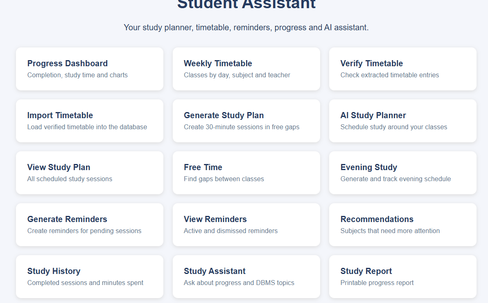
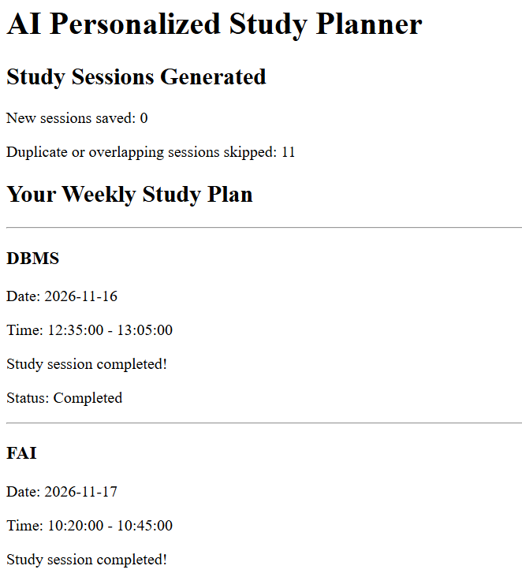
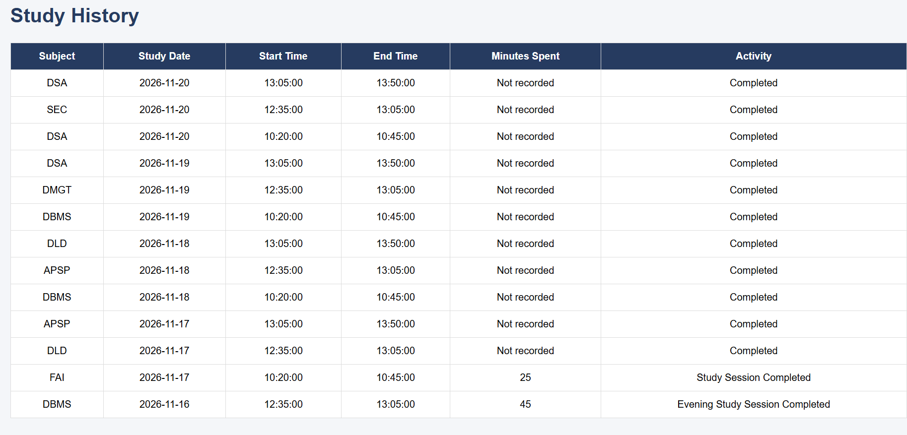

# AI Personalized Study Planner

## Project Overview

The **AI Personalized Study Planner** is a web-based student academic assistant designed to help students organize their study schedules, manage academic activities, monitor their progress, and improve their learning experience.

The system provides timetable management, automated study planning, study reminders, progress tracking, and an educational chatbot.

## Features

### 1. Timetable Management
- Manage student timetables.
- Extract timetable information using OCR.
- Verify timetable information.

### 2. Study Planner
- Generate study plans.
- Organize study sessions.
- Mark completed study sessions.
- Manage evening study sessions.

### 3. Study Reminders
- Generate study reminders.
- Receive browser notifications.
- Get reminders before scheduled evening study sessions.

### 4. Progress Tracking
- View daily and weekly study progress.
- Track subject-wise progress.
- View study history.
- Monitor study performance.

### 5. Study Reports
- Generate monthly study reports.
- View study performance summaries.
- Print or save study reports as PDF.

### 6. Educational Study Assistant
- Ask academic questions through the chatbot.
- Get educational explanations for supported programming and computer science topics.
- Receive study recommendations.

## Technologies Used

| Technology | Purpose |
|---|---|
| HTML | Web page structure |
| CSS | Website styling |
| JavaScript | Interactive features |
| PHP | Backend development |
| MySQL | Database management |
| Python | Timetable OCR and processing |
| Tesseract OCR | Text extraction from timetable images |
| XAMPP | Local development environment |
| Git and GitHub | Version control and project storage |

## Project Folder Structure

```text
student_assistant/
├── api/
├── assets/
├── pages/
├── python/
├── screenshots/
│   └── dashboard.png
├── sql/
├── index.php
└── README.md
```

## Installation and Setup

### Requirements
- XAMPP
- PHP
- MySQL
- Python
- Tesseract OCR
- Web browser
- Visual Studio Code (recommended)

### Steps to Run the Project

1. Install and open XAMPP.
2. Start Apache and MySQL.
3. Place the project folder inside `C:\xampp\htdocs\`.
4. Open [phpMyAdmin](http://localhost/phpmyadmin/).
5. Create a database named `student_assistant`.
6. Import the SQL files from the `sql` folder in the required order.
7. Configure your local database connection in `config/database.php`.
8. Open the project:

   `http://localhost/student_assistant/`

## Database

The project uses MySQL to store and manage:
- Study sessions
- Timetable information
- Student progress
- Study reminders
- Evening study sessions
- Chat history

## Future Enhancements

- Improved personalized study recommendations.
- More advanced AI-powered academic assistance.
- Enhanced timetable recognition.
- Student authentication and individual profiles.
- Online deployment and accessibility.

## Project Purpose

The main purpose of this project is to help students manage their academic schedules efficiently, develop consistent study habits, and monitor their learning progress through a single web-based platform.

## Developer

- **Project Name:** AI Personalized Study Planner
- **Domain:** Artificial Intelligence and Full Stack Web Development
- **Backend:** PHP and MySQL
- **Frontend:** HTML, CSS and JavaScript

---

## Application Screenshots

### Main Dashboard


### Study Planner


### Study History

